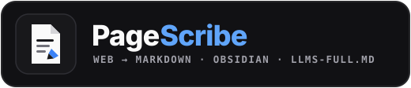

<div align="center">
  
  <h1>PageScribe</h1>
  <p><strong>Local-first Manifest V3 Chrome extension for clean web-to-Markdown clipping, Obsidian export, PDF parsing, AI Q&amp;A, and polite multi-page crawling.</strong></p>

  <p>
    
    
    
    
  </p>
</div>

---

## Overview

**PageScribe** turns noisy web pages, documentation sites, and PDFs into structured, portable knowledge—without requiring an account or sending your browsing data to third-party servers.

Built on **WXT** and **Chrome Manifest V3**, PageScribe is designed around three core principles:

1. **Least-Privilege Security**: Single-page clipping uses `activeTab` + on-demand `scripting` injection (`registration: 'runtime'`). Broad `<all_urls>` host access is declared in `optional_host_permissions` and only requested when you explicitly start a multi-page crawl.
2. **Resilient MV3 Architecture**: Heavy PDF parsing via `pdfjs-dist` is isolated in a dedicated **Offscreen Document** (`offscreen.html`), keeping the background service worker lightweight (`~155 kB`) and fast to wake.
3. **Offline-First Intelligence, Optional AI**: Summarization, keyword extraction, sentiment, readability, entity extraction, and language detection run 100% locally by default—with optional **Chrome Built-in AI** or **BYOK OpenAI-compatible** endpoints for abstractive summaries and Q&A.

---

## Features

### Web Clipping & Knowledge Export
- **Clean Article Extraction**: Uses `@mozilla/readability` to strip navigation, ads, and boilerplate, with automatic fallback to `document.body` on non-article pages.
- **GFM-Aware Markdown**: Converts HTML to GitHub-Flavored Markdown via `turndown` + `turndown-plugin-gfm`, preserving tables, task lists, strikethroughs, and fenced code blocks.
- **Dynamic Clip Templates**: Format exports with built-in templates (**Standard Frontmatter**, **Obsidian Research Note**, **Minimal Clean Markdown**) supporting variables such as `{{title}}`, `{{url}}`, `{{author}}`, `{{date}}`, `{{clippedDate}}`, `{{language}}`, `{{wordCount}}`, `{{readingTime}}`, `{{keywords}}`, `{{summary}}`, `{{highlights}}`, and `{{content}}`.
- **One-Click Obsidian Export**: Send the clipped note directly into your vault via `obsidian://new` URI deep-linking.
- **On-Page Web Highlighter**: Highlight and save quotes directly on live pages via the right-click context menu (**PageScribe: Highlight & save quote**); saved highlights are listed per-URL in the Page tab and automatically included in exported notes.
- **Custom Domain Selector Rules**: Configure per-domain CSS `include` and `exclude` selectors to target specific containers (e.g., `main`, `article.post`) or strip unwanted elements (e.g., `.sidebar`, `.ads`).
- **Bounded Auto-Scroll & XSS Shield**: Optional auto-scroll loads lazy content before extraction; all HTML previews and exports are sanitized through a detached DOM engine (`sanitizeHTML`).

### Content Intelligence & Optional AI
- **Offline Summarization**: Weighted TF-IDF sentence scoring with position bias in `short`, `medium`, or `long` lengths (paragraph or bullet-point format).
- **Optional Local / BYOK AI**:
  - **Chrome Built-in AI** (`LanguageModel`) when available in Chrome.
  - **OpenAI-Compatible (BYOK)** endpoint, model, and API key configuration for abstractive summarization and **Ask AI / Q&A** over pages and PDFs.
- **Page Analysis**:
  - **Language Detection**: Identifies English, Spanish, French, German, and Italian.
  - **Sentiment & Readability**: Polarity score, Flesch Reading Ease, and Flesch-Kincaid Grade Level.
  - **Entity Extraction & TOC**: Extracts emails, phone numbers, and URLs, and builds a Markdown Table of Contents from headings.
- **Ranked Keywords**: Frequency-scored keyword extraction (`keyword-extractor`).

### Polite Multi-Page Crawler
- **`robots.txt` Compliance**: Fetches and caches `User-agent: *` `Allow`/`Disallow` directives per origin (enabled by default).
- **Concurrent Worker Pool**: Configurable concurrency (1–3 tab workers), crawl depth, max pages, request delay, domain restriction, and regex URL exclusion filters.
- **Live Progress & Selective Export**: Tracks per-URL status (`success`, `failed`, `skipped`) in real time, lets you check/uncheck individual crawled pages, and exports to **JSON**, **CSV**, or an LLM-ready **`llms-full.md` Knowledge Pack** (indexed, concatenated Markdown for NotebookLM, Claude Projects, or RAG).
- **Resilient Lifecycle**: Waits for tab load completion (`tabs.onUpdated`), supports mid-crawl cancellation (**Stop**), and automatically resets crawl state on service worker startup.

### Offscreen PDF Processing
- Upload any local PDF to extract text, page count, and document metadata inside `offscreen.html` without blocking the service worker.
- Run **Summarize**, **Extract Keywords**, or **Ask AI / Q&A** directly on the extracted PDF text.

### Productivity & Workspace
- **Side Panel Mode (`chrome.sidePanel`)**: Pop PageScribe out into Chrome's persistent Side Panel to keep previews, Q&A, and crawl logs open while browsing.
- **Right-Click Context Menus**: Save or summarize highlighted text on any page without opening the popup.
- **Searchable History & Persistence**: Search and filter past keywords, summaries, and Q&A results; export history to JSON or CSV; persist theme and user preferences in `chrome.storage.local`.

---

## Keyboard Shortcuts

| Shortcut | Action |
| :--- | :--- |
| `Alt+Shift+M` | Save active page as Markdown using your active template |
| `Alt+Shift+P` | Open the PageScribe Side Panel |

*(Shortcuts can be customized at `chrome://extensions/shortcuts`.)*

---

## Permissions Explained

| Permission | Purpose |
| :--- | :--- |
| `activeTab` & `scripting` | Inject content script on demand into the active tab when you trigger an action |
| `tabs` | Query active tab URL/title and manage background tabs during crawling |
| `storage` | Persist preferences, selector rules, highlights, AI config, and history locally |
| `downloads` | Save exported Markdown, HTML, JSON, CSV, and `llms-full.md` files |
| `offscreen` | Run `pdfjs-dist` in an isolated offscreen document |
| `sidePanel` | Provide the persistent Side Panel UI |
| `contextMenus` | Enable right-click save, summarize, and highlight actions on selected text |
| `optional_host_permissions: ["<all_urls>"]` | Requested at runtime only when you start a multi-page crawl |

---

## Project Structure

```text
PageScribe/
├── assets/                    # Extension logo and static assets
├── entrypoints/
│   ├── background.ts          # MV3 service worker (messaging, crawler, commands, context menus, offscreen)
│   ├── content.ts             # On-demand content script (Readability, Turndown+GFM, selector rules, highlights)
│   ├── offscreen/             # Offscreen document for pdfjs-dist PDF parsing
│   ├── popup/                 # Extension popup UI (React 19)
│   └── sidepanel/             # Chrome Side Panel entrypoint reusing App
├── utils/
│   ├── content.ts             # Stats, TF-IDF summarization, sentiment, readability, entities, TOC, language
│   ├── dom.ts                 # sanitizeHTML, escapeHTML, parseDOMMetadata
│   ├── highlights.ts          # Highlight URL normalization and Markdown formatting
│   ├── llm.ts                 # Offline, Chrome AI, and OpenAI-compatible summarization & Q&A
│   ├── robots.ts              # robots.txt parser and URL matcher
│   ├── rules.ts               # Domain CSS selector rule matching
│   └── templates.ts           # Dynamic clip templates and obsidian:// URI builder
├── tests/                     # Bun unit tests
├── e2e/                       # Playwright extension E2E smoke tests
└── wxt.config.ts              # WXT & MV3 manifest configuration
```

---

## Development & Testing

### Prerequisites
- [Bun](https://bun.sh/) (v1.2+)

### Commands
```bash
# Install dependencies
bun install

# Type-check
bun run compile

# Run unit tests
bun run test

# Build production extension (.output/chrome-mv3)
bun run build

# Run Playwright E2E smoke tests (first time: bunx playwright install chromium)
bun run test:e2e
```

### Load Unpacked in Chrome
1. Run `bun run build`.
2. Open `chrome://extensions/` and enable **Developer mode**.
3. Click **Load unpacked** and select `.output/chrome-mv3`.
