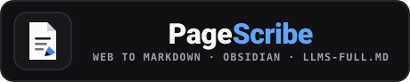
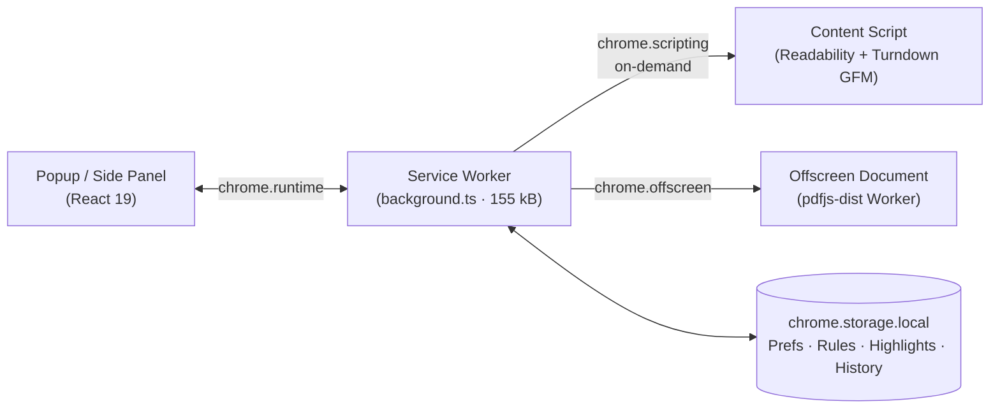

<div align="center">
  

  <h1>PageScribe</h1>

  <p>
    <strong>Clip any web page, docs site, or PDF into clean Markdown, Obsidian notes, or an LLM-ready <code>llms-full.md</code> knowledge pack — 100% local-first.</strong>
  </p>

  <p>
    <a href="https://github.com/amafjarkasi/PageScribe/actions/workflows/ci.yml">
      
    </a>
    
    
    
    
  </p>

  <p>
    <a href="#-overview">Overview</a> •
    <a href="#-core-features">Features</a> •
    <a href="#%EF%B8%8F-architecture">Architecture</a> •
    <a href="#%EF%B8%8F-keyboard-shortcuts">Shortcuts</a> •
    <a href="#-quick-start">Quick Start</a>
  </p>
</div>

---

## 💡 Overview

**PageScribe** is a privacy-first Chrome extension built for researchers, developers, and PKM (Personal Knowledge Management) workflows. Instead of bloated cloud clippers or fragile scrapers, PageScribe turns live web pages, multi-page documentation sites, and local PDFs into **clean, structured knowledge** right in your browser—with **zero accounts, zero telemetry, and least-privilege permissions**.

<table>
  <tr>
    <td width="50%" valign="top">
      <h3>✂️ Clip, Highlight &amp; Send to Obsidian</h3>
      <p>Extract clutter-free articles with <strong>Readability + GFM Markdown</strong> (tables, task lists, fenced code), highlight quotes directly on the page, format with dynamic <code>{{variables}}</code>, and send straight to your vault via <code>obsidian://new</code>.</p>
    </td>
    <td width="50%" valign="top">
      <h3>🕷️ Polite Crawler &amp; <code>llms-full.md</code></h3>
      <p>Crawl docs sites or blogs with <strong><code>robots.txt</code> compliance</strong>, 1–3 concurrent workers, live per-URL logs, and selective export to <strong>JSON</strong>, <strong>CSV</strong>, or a single indexed <strong><code>llms-full.md</code></strong> pack for NotebookLM &amp; Claude Projects.</p>
    </td>
  </tr>
  <tr>
    <td width="50%" valign="top">
      <h3>🧠 Offline Intelligence &amp; BYOK AI</h3>
      <p>Zero-config <strong>TF-IDF summarization</strong>, ranked keywords, sentiment, Flesch-Kincaid readability, entity extraction, and language detection—plus optional <strong>Chrome Built-in AI</strong> or <strong>OpenAI-compatible</strong> Q&amp;A.</p>
    </td>
    <td width="50%" valign="top">
      <h3>🔒 Hardened MV3 &amp; Offscreen PDF</h3>
      <p>Uses <code>activeTab</code> + on-demand <code>scripting</code> (no install-time <code>&lt;all_urls&gt;</code>), isolates <code>pdfjs-dist</code> in an <strong>Offscreen Document</strong> (<code>~155 kB</code> worker), and sanitizes every HTML byte via a detached DOM shield.</p>
    </td>
  </tr>
</table>

---

## ⚡ Core Features

### 1. Web Clipping & Knowledge Export
- **Clean Article, AI Chat & YouTube Extraction**: Uses `@mozilla/readability` for articles, site-specific adapters for **ChatGPT, Claude, Gemini, and Perplexity** threads, and timestamped caption/transcript extraction on **YouTube**.
- **GFM Markdown + LaTeX Math**: Powered by `turndown` + `turndown-plugin-gfm` with pre-Turndown **KaTeX / MathJax / MathML** preservation (`$...$` and `$$...$$`).
- **Dynamic Clip Templates & Auto-Graph**: Choose from **Standard Frontmatter**, **Obsidian Research Note**, or **Minimal Clean Markdown**—automatically populating `{{tags}}`, `{{wikilinks}}` (matched against history & vault notes), stats, keywords, summary, and highlights.
- **Flexible Export Targets**: Download `.md`/`.html`, save a **self-contained `.zip` with offline images**, write directly to a **Local Folder** (File System Access API), send straight to **Obsidian** (`obsidian://new`), or **Clip All Window Tabs** into a single `research_session_llms-full.md`.
- **On-Page Highlighter & Reader Mode**: Right-click selections to highlight (`<mark>`), or toggle the distraction-free **Reader Mode** overlay with font controls and `speechSynthesis` **Read-Aloud**.
- **Custom Domain Selector Rules & Auto-Scroll**: Save per-domain CSS `include`/`exclude` selectors and optionally auto-scroll lazy-loaded pages.

<details>
<summary><strong>Supported Template Variables</strong> (click to expand)</summary>

| Variable | Description |
| :--- | :--- |
| `{{title}}` | Extracted article or document title |
| `{{url}}` | Source page URL |
| `{{author}}` | Meta/OpenGraph/Twitter author |
| `{{date}}` | Published date metadata |
| `{{clippedDate}}` | Current ISO date (`YYYY-MM-DD`) |
| `{{site}}` | Site name (`og:site_name`) |
| `{{description}}` | Meta/OpenGraph description |
| `{{language}}` | Detected page language |
| `{{wordCount}}` | Word count |
| `{{readingTime}}` | Estimated reading time (minutes) |
| `{{keywords}}` | Top ranked keywords |
| `{{summary}}` | Auto-generated short summary |
| `{{highlights}}` | Formatted `## Highlights` blockquotes for the URL |
| `{{content}}` | Extracted GFM Markdown body |

</details>

### 2. Polite Multi-Page Crawler & Change Watcher
- **`robots.txt` Compliance**: Fetches and caches `User-agent: *` `Allow`/`Disallow` rules per origin (enabled by default).
- **Sitemap & RSS/Atom Discovery**: Auto-discover URLs from `/sitemap.xml`, `/rss.xml`, `/feed.xml`, or `/atom.xml` right from the Crawl tab.
- **Concurrent Worker Pool**: Run 1–3 background tab workers with configurable depth, max pages, request delay, domain lock, and regex URL exclusions.
- **Live Progress & Selective Export**: Inspect `success` / `failed` / `skipped` statuses in real time, check/uncheck crawled pages, and export to **JSON**, **CSV**, or **`llms-full.md`**.
- **Page Change Watcher (`chrome.alarms`)**: Pin URLs to periodically check for content diffs (`+added / -removed` lines) with desktop notifications.

### 3. Content Intelligence & Optional AI
- **Offline (Default)**: Weighted TF-IDF summarization (`short`/`medium`/`long`, paragraph or bullets), ranked keywords (`keyword-extractor`), sentiment polarity, Flesch-Kincaid readability, entity extraction (emails, phones, URLs), Markdown TOC, and 5-language detection.
- **Chrome Built-in AI**: Uses `LanguageModel` locally when available in Chrome.
- **OpenAI-Compatible (BYOK)**: Configure any compatible endpoint, model, and API key for abstractive summaries and **Ask AI / Q&A** on pages and PDFs.

### 4. Offscreen PDF & Side Panel Workspace
- **Offscreen PDF Worker**: Parses uploaded PDFs inside `offscreen.html` via `pdfjs-dist` so the service worker stays fast and lean.
- **Persistent Side Panel**: Pop PageScribe into Chrome's `sidePanel` to keep previews, Q&A, and crawl logs open while browsing.
- **Context Menus & History**: Right-click selections to save, summarize, or highlight; search/filter history and export to JSON/CSV.

---

## 🏗️ Architecture



<details>
<summary><strong>Project Structure &amp; Permissions</strong> (click to expand)</summary>

```text
PageScribe/
├── assets/banner.svg          # Extension SVG banner lockup
├── entrypoints/
│   ├── background.ts          # MV3 service worker (crawler, commands, context menus, offscreen)
│   ├── content.ts             # On-demand content script (Readability, Turndown+GFM, highlights)
│   ├── offscreen/             # Isolated offscreen document for pdfjs-dist
│   ├── popup/                 # Extension popup UI
│   └── sidepanel/             # Chrome Side Panel entrypoint
├── utils/
│   ├── content.ts             # Stats, TF-IDF summary, sentiment, readability, entities, TOC, language
│   ├── dom.ts                 # sanitizeHTML, escapeHTML, parseDOMMetadata
│   ├── extractors.ts          # AI chat adapters, YouTube transcripts, KaTeX/MathML preservation
│   ├── feeds.ts               # Sitemap.xml & RSS/Atom feed discovery
│   ├── graph.ts               # Auto-tagging & [[WikiLink]] graph suggester
│   ├── highlights.ts          # Highlight URL normalization and Markdown formatting
│   ├── llm.ts                 # Offline, Chrome AI, and OpenAI-compatible summarization & Q&A
│   ├── localFolder.ts         # File System Access API + IndexedDB directory handle persistence
│   ├── robots.ts              # robots.txt parser and matcher
│   ├── rules.ts               # Domain CSS selector rule matching
│   ├── templates.ts           # Dynamic clip templates and obsidian:// URI builder
│   ├── watcher.ts             # Page change watcher & line-diff engine
│   └── zip.ts                 # Pure-TS ZIP builder & offline image bundler
├── tests/                     # Bun unit tests (42 tests)
├── e2e/                       # Playwright Chromium extension smoke tests
└── wxt.config.ts              # WXT & MV3 manifest configuration
```

| Permission | Purpose |
| :--- | :--- |
| `activeTab` &amp; `scripting` | Inject content script on demand into the active tab when you trigger an action |
| `tabs` | Query active tab URL/title and manage background tabs during crawling |
| `storage` | Persist preferences, selector rules, highlights, AI config, and history locally |
| `downloads` | Save exported Markdown, HTML, JSON, CSV, and `llms-full.md` files |
| `offscreen` | Run `pdfjs-dist` in an isolated offscreen document |
| `sidePanel` | Provide the persistent Side Panel UI |
| `contextMenus` | Right-click save, summarize, and highlight actions on selected text |
| `optional_host_permissions: ["<all_urls>"]` | Requested at runtime only when starting a multi-page crawl |

</details>

---

## ⌨️ Keyboard Shortcuts

| Shortcut | Action |
| :--- | :--- |
| `Alt+Shift+M` | Instantly save the active page as Markdown using your active template |
| `Alt+Shift+P` | Open the PageScribe Side Panel |

*(Customize anytime at `chrome://extensions/shortcuts`.)*

---

## 🚀 Quick Start

```bash
# 1. Install dependencies
bun install

# 2. Type-check & run unit tests
bun run compile && bun run test

# 3. Build production extension (.output/chrome-mv3)
bun run build

# 4. Run Playwright E2E smoke tests (first time: bunx playwright install chromium)
bun run test:e2e
```

**Load in Chrome:** Open `chrome://extensions/` → enable **Developer mode** → click **Load unpacked** → select `.output/chrome-mv3`.
